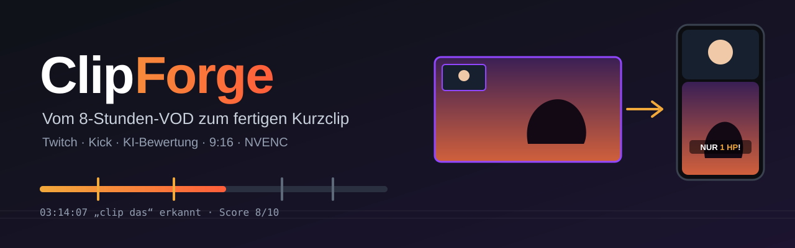
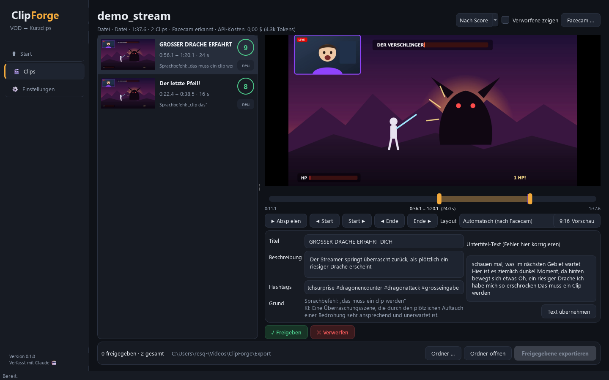
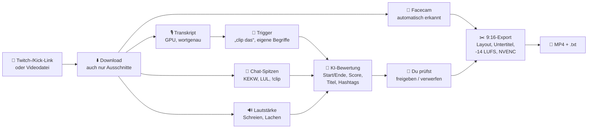
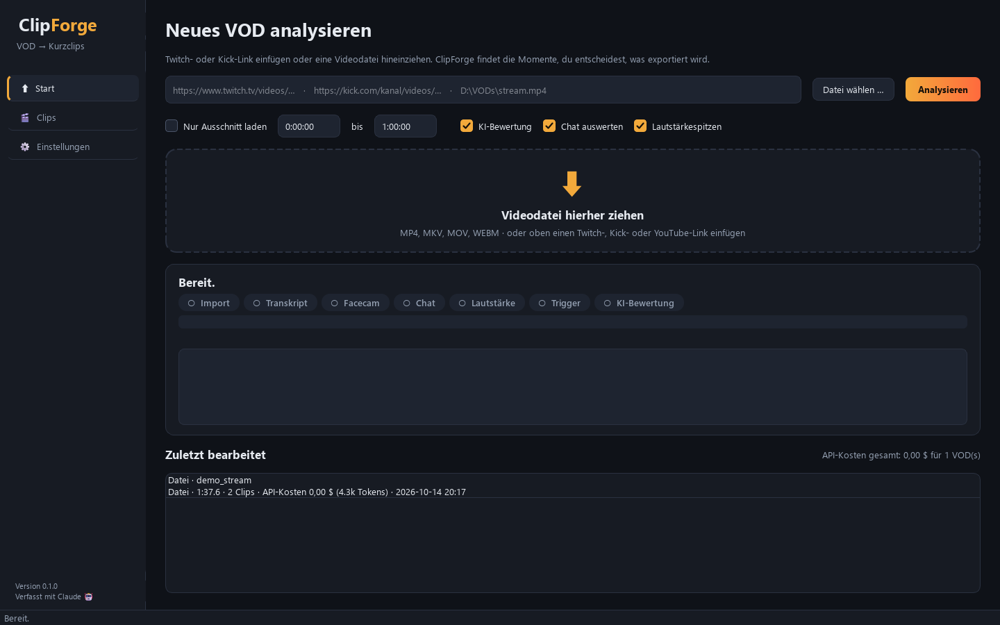
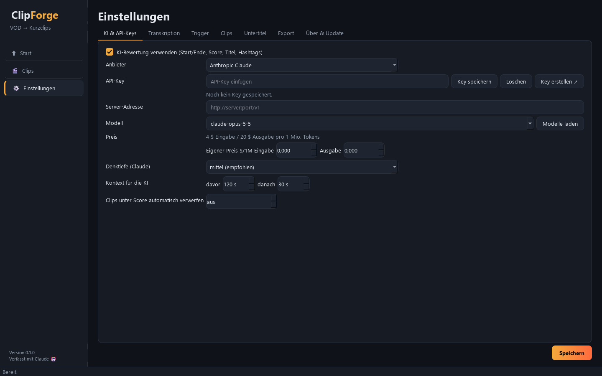
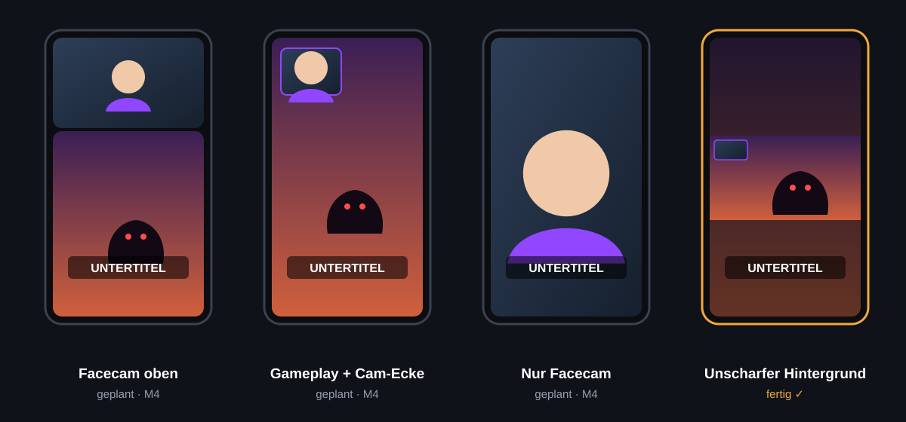
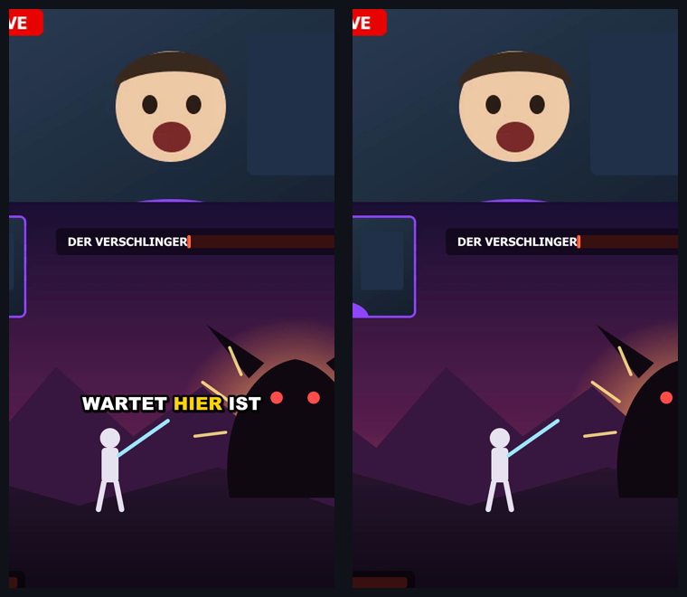

<p align="center">
  
</p>

<p align="center">
  
  
  
  
  
  
  
</p>

**ClipForge** schaut sich deine kompletten Twitch- oder Kick-VODs an, findet die Momente, die als Kurzclip funktionieren, und schneidet sie fertig im Hochformat für **TikTok, YouTube Shorts und Instagram Reels**: mit Facecam an der richtigen Stelle, Untertiteln im TikTok-Stil, Titel und Hashtags. Link rein, Clips prüfen, exportieren.

<p align="center">
  
</p>

---

## Neu in 0.2.0 – das XXL-Update

- **Handcam und markierte Objekte:** Handcam-Fenster werden erkannt oder per Rahmen festgelegt (neue Layouts „Handcam oben“, „Facecam + Handcam + Gameplay“, „Nur Handcam“). Ein markiertes Objekt, etwa ein Bär als Facecam, wird in jedem Clip wiedergefunden, verfolgt und mitgezoomt.
- **Live-Vorschau im Facecam-Dialog:** Beim Ziehen des Rahmens erscheint sofort das fertige 9:16-Bild im gewählten Layout.
- **Neue Oberfläche:** sanfte Seitenübergänge, kurze Meldungen, laufende Arbeit in der Seitenleiste, VOD-Karten mit Vorschaubild, Clip-Editor in Reitern, Tastenkürzel (Strg+1/2/3, Strg+Enter, Strg+Entf, Strg+Leertaste).
- **Einstellungen neu sortiert:** Bereiche in einer Seitenleiste mit Erklärung, neuer Bereich „Facecam-Profile“.
- **Crash-Schutz:** Fehler beenden ClipForge nicht mehr, harte Abstürze landen mit Stacktrace in `logs\crash.log`, nach einem Absturz ist das letzte VOD wieder offen. Der Starter startet ClipForge nach einem Absturz neu.
- **4× schnellere Transkription** (Stapelverarbeitung auf der GPU).
- **Über 40 Fehler behoben**, darunter: Bearbeitungen gingen beim Neu-Analysieren verloren, Chat-Spitzen wurden zu 90 % verschluckt, Export mit Vollbild-Kamera, Handyvideos im Hochformat und 4K-Quellen.
- **Sicherheit:** Updates nur aus geprüften Releases, API-Keys gehen nie an fremde Server-Adressen, Videostreams dürfen keine lokalen Dateien oder Geräte im Heimnetz ansprechen.
- **232 automatische Tests**, darunter jedes Layout mit jeder Kamera-Situation als echter FFmpeg-Lauf.

---

## Inhalt

- [So funktioniert's](#so-funktionierts)
- [Funktionen](#funktionen)
- [Installation](#installation)
- [Benutzung](#benutzung)
- [KI-Anbieter und Kosten](#ki-anbieter-und-kosten)
- [Wie ClipForge Momente findet](#wie-clipforge-momente-findet)
- [Facecam und Layouts](#facecam-und-layouts)
- [Untertitel und Feinschliff](#untertitel-und-feinschliff)
- [Gesamttest](#gesamttest)
- [Speicherorte](#speicherorte)
- [Probleme lösen](#probleme-lösen)
- [Projektstruktur](#projektstruktur)

---

## So funktioniert's



1. **Import:** Twitch- oder Kick-Link, YouTube oder eine lokale Datei. Lange VODs werden in 10-Minuten-Abschnitten verarbeitet. Bricht etwas ab, geht es beim nächsten Start genau dort weiter.
2. **Analyse:** Transkript mit Zeitstempel für jedes Wort (lokal auf der GPU), Facecam-Erkennung, Chat- und Lautstärkespitzen.
3. **Trigger:** Stellen mit „clip das“, deinen eigenen Begriffen, viel Chat-Reaktion oder lauten Momenten werden zu Clip-Kandidaten.
4. **KI-Bewertung:** Eine KI liest das Transkript rund um jede Stelle und bestimmt, wo der Moment beginnt und endet, damit der Clip ohne Vorwissen verständlich ist. Dazu kommen Viral-Score, Titel, Beschreibung und Hashtags.
5. **Prüfen:** In der Oberfläche siehst du alle Clips mit Score und Grund, passt Start und Ende an, wählst das Layout und gibst frei.
6. **Export:** 1080×1920, Facecam-Layout, Untertitel, Lautheit, GPU-Kodierung. Pro Clip eine `.txt` zum Hochladen.

---

## Funktionen

| Bereich | Was ClipForge kann |
|---|---|
| **Import** | Twitch, Kick, YouTube und alles, was yt-dlp kann. Lokale MP4/MKV/MOV per Drag & Drop. Nur einen Ausschnitt laden (lädt gezielt nur die nötigen Videostücke, auch bei Stunde 8 schnell). |
| **Transkription** | Lokal mit faster-whisper `large-v3-turbo` auf der NVIDIA-GPU, Sprache automatisch. Alternativ OpenAI- oder Groq-Whisper per API. |
| **Trigger** | Sprachbefehle („clip das“, „clip it“, „das muss ein Clip werden“ …), eigene Begriffe mit unscharfer Erkennung, Chat-Spitzen bei Twitch und Kick, Lautstärkespitzen |
| **KI** | 12 Anbieter (Claude, OpenAI, Gemini, Mistral, Groq, DeepSeek, xAI, OpenRouter, NVIDIA NIM mit kostenlosem Key, Ollama, LM Studio, eigener Server). Schnitt an Satzgrenzen, Score 1–10, Titel, Beschreibung, Hashtags |
| **Kosten** | Schätzung vor jeder Analyse **und** tatsächlich verbrauchtes API-Guthaben pro VOD |
| **Facecam** | Automatisch erkannt, auch wenn das Spiel Gesichter zeigt **und auch ohne menschliches Gesicht** (Tier-Maskottchen wie ein Bär, VTuber, PNGtuber). Von Hand korrigierbar, als Profil pro Streamer gespeichert |
| **Layouts** | Facecam oben, Cam-Ecke, nur Facecam, unscharfer Hintergrund, Zuschnitt, automatisch |
| **Bild** | Gameplay-Ausschnitt nach Bewegung gewählt (Facecam wird gemieden), schwarze Kino-Balken entfernt, Gesicht sanft nachgeführt |
| **Untertitel** | Wortgenau, aktives Wort hervorgehoben, Schrift/Farbe/Umriss/Position frei, Text vor dem Export korrigierbar |
| **Feinschliff** | -14 LUFS, Stille am Anfang/Ende entfernen, Intro/Outro, Wasserzeichen |
| **Export** | MP4 H.264/H.265, 30/60 fps, NVENC, Stapel-Export aller freigegebenen Clips, Dateiname nach Muster `Datum_Streamer_Titel` |
| **Oberfläche** | Dark Mode, alles im Hintergrund (Fenster friert nie ein), Update-Knopf |

---

## Installation

### Einfach: Setup.exe

1. **[ClipForge-Setup herunterladen](https://github.com/MoinMornhart/ClipForge/releases/latest)** (ca. 18 MB).
2. Doppelklicken. Zeigt Windows „Der Computer wurde durch Windows geschützt“, auf **Weitere Informationen → Trotzdem ausführen** klicken (die Datei ist nicht kostenpflichtig signiert).
3. **Weiter → Installieren.** Es öffnet sich ein Fenster, das einmalig rund 3 GB an Bibliotheken lädt (Spracherkennung, Video, KI). Je nach Leitung 5 bis 20 Minuten.
4. Fertig. ClipForge startet über das Desktop-Symbol oder das Startmenü.

Du brauchst dafür **kein Python und keine Adminrechte**. Der Installer bringt eine eigene Python-Version mit und installiert nach `%LOCALAPPDATA%\Programs\ClipForge`. Belegt werden rund 3,3 GB, dazu beim ersten Start 1,6 GB für das Spracherkennungsmodell. Deinstallieren geht über **Einstellungen → Apps**.

**Voraussetzungen:** Windows 10 oder 11 (64 Bit). Eine NVIDIA-Grafikkarte wird empfohlen; ohne läuft alles auf dem Prozessor, nur langsamer. FFmpeg wird bei Bedarf automatisch über winget installiert.

### Für Entwickler: aus dem Quellcode

Voraussetzung: [Python 3.11](https://www.python.org/downloads/) und Git.

```bat
git clone https://github.com/MoinMornhart/ClipForge.git
cd ClipForge
install.bat
```

`install.bat` legt eine Python-Umgebung unter `%LOCALAPPDATA%\ClipForge` an, installiert alle Pakete (inkl. CUDA-Bibliotheken), bei Bedarf FFmpeg und eine Desktop-Verknüpfung. Die Setup.exe selbst baust du mit `powershell -ExecutionPolicy Bypass -File installeruild.ps1` (braucht Inno Setup 6 und PyInstaller).

---

## Benutzung

### Mit der Oberfläche

1. **ClipForge** über das Desktop-Symbol oder das Startmenü starten. Du kannst eine Videodatei auch direkt auf das ClipForge-Symbol ziehen.
2. Unter **Start** einen Twitch- oder Kick-Link einfügen oder eine Videodatei hineinziehen, dann **Analysieren**.
3. Vor kostenpflichtigen Schritten zeigt ClipForge die geschätzten Kosten und fragt nach.
4. Unter **Clips** jeden Clip prüfen: abspielen, Start und Ende mit dem Regler verschieben, Layout wählen, Titel und Untertitel-Text korrigieren, dann **Freigeben** oder **Verwerfen**.
5. **Freigegebene exportieren**. Die Clips landen in `Videos\ClipForge\Export`.

<p align="center">
  
  
</p>

### Mit der Kommandozeile

`cf` steht hier für `%LOCALAPPDATA%\ClipForge\venv\Scripts\python.exe -m clipforge`:

```bat
cf run "https://www.twitch.tv/videos/2899619133"           :: analysieren + exportieren
cf run "https://kick.com/xqc/videos/…" --section 2:00:00-2:30:00
cf analyze D:\VODs\stream.mp4 --no-ai                      :: nur analysieren, ohne KI
cf run D:\VODs\stream.mp4 --layout stack -y                :: Layout fest, ohne Kostenabfrage
cf key set anthropic | cf key list                         :: API-Keys
cf keyword add "was geht ab" --threshold 75                :: eigener Begriff
cf models ollama                                           :: Modelle eines Anbieters
cf costs                                                   :: API-Kosten aller VODs
cf check                                                   :: Systemprüfung
```

---

## KI-Anbieter und Kosten

Du brauchst nur **einen** Anbieter. Lokal über Ollama oder LM Studio kostet die KI-Bewertung gar nichts.

| Anbieter | Key | Schnittstelle |
|---|:---:|---|
| **Anthropic Claude** (Standard: `claude-opus-5-5`) | ✅ | offizielles SDK, strukturierte Antwort |
| OpenAI · Google Gemini · Mistral · Groq · DeepSeek · xAI · OpenRouter | ✅ | OpenAI-kompatibel |
| NVIDIA NIM ([build.nvidia.com](https://build.nvidia.com/settings/api-keys)) | ✅ kostenlos | OpenAI-kompatibel, Ratenlimit; Modelle z. B. Nemotron, Kimi, DeepSeek, GLM |
| Ollama · LM Studio (lokal) | – | `localhost` |
| Eigener Server | optional | beliebige OpenAI-kompatible URL |

> [!IMPORTANT]
> API-Keys landen **ausschließlich in der Windows-Anmeldeinformationsverwaltung**, nie in Dateien, Logs oder im Repo. In der Oberfläche: Einstellungen → KI & API-Keys → Key einfügen → **Key speichern**.

### Was zahle ich pro VOD?

ClipForge zeigt zwei Zahlen:

- **Vorher die Schätzung:** vor der Transkription (nur Dauer bekannt) und noch einmal vor der KI-Bewertung (genau pro gefundenem Clip). Du kannst jeweils abbrechen.
- **Danach die tatsächlichen Kosten:** Die wirklich verbrauchten Tokens und Audiominuten werden pro VOD gespeichert und in Euro-Cent-genauen Dollarbeträgen angezeigt, in der Clip-Übersicht, in „Zuletzt bearbeitet“ (mit Gesamtsumme) und mit `cf costs`:

```text
Datum       Streamer             Kosten  Details
2026-10-13  Papaplatte           0.41 $  38.2k Tokens  · CRAFTATTACK TAG 4 …
2026-10-13  xQc                  0.00 $  nur lokal     · nopixel V …

Gesamt: 0.41 $ für 1 VOD(s) mit API-Nutzung
```
<sub>Beispielausgabe.</sub>

**Richtwerte für ein 8-Stunden-VOD** (Annahme: rund 4 Trigger pro Stunde, also 32 Clips):

| Transkription | KI-Modell | Kosten pro VOD |
|---|---|---|
| lokal (GPU) | Ollama / LM Studio | **0,00 $** |
| lokal (GPU) | Claude Haiku 5.5 | ca. 0,01–0,05 $ |
| lokal (GPU) | Claude Sonnet 5.5 | ca. 0,17–1,03 $ |
| lokal (GPU) | Claude Opus 5.5 | ca. 0,34–2,07 $ |
| Groq Whisper | Claude Opus 5.5 | ca. 0,66–2,39 $ |
| OpenAI Whisper | Claude Opus 5.5 | ca. 3,22–4,95 $ |

Für Modelle anderer Anbieter kennt ClipForge die Preise nicht verlässlich. Trag sie in den Einstellungen unter „Eigener Preis“ ein, dann stimmen auch dort Schätzung und tatsächliche Kosten.

### Wie die KI schneidet

Die KI bekommt das Transkript rund um den Trigger (120 s davor, 30 s danach) als nummerierte Zeilen und wählt **Start- und Endzeile**. Die Schnittpunkte berechnet ClipForge aus den Wortzeitstempeln. So kann die KI keine Zeiten erfinden, jeder Clip beginnt und endet an einer Satzgrenze, und Mindest- und Höchstlänge werden immer eingehalten.

---

## Wie ClipForge Momente findet

**Sprachbefehle und eigene Begriffe** werden unscharf verglichen: Transkript und Begriff werden gleich vereinfacht (Kleinschreibung, Umlaute, k→c, doppelte Buchstaben) und dann auf Ähnlichkeit geprüft. Jedes Kernwort muss vorkommen.

| Gesagt / transkribiert | Begriff | Ergebnis |
|---|---|---|
| „Klipp das!“ | clip das | ✅ erkannt |
| „klipp des bitte“ | clip das | ✅ erkannt |
| „Das muss ein Clip werden.“ | das muss ein clip werden | ✅ erkannt |
| „das ist ein Fehler“ | das ist ein clip | ❌ ignoriert, Kernwort fehlt (echter Fehlalarm aus einem Test, behoben) |

**Chat-Spitzen:** Der Chat des VODs wird geladen (Twitch und Kick). Eine Spitze ist ein 10-Sekunden-Fenster mit deutlich mehr Nachrichten als in den Minuten davor und danach. Reaktionen wie KEKW, LUL, OMEGALUL oder `!clip` zählen doppelt. Weil der Chat einige Sekunden verzögert reagiert, beginnt der Clip entsprechend früher.

**Lautstärkespitzen:** Schreien, Lachen und Jubel werden relativ zum Umfeld erkannt. Ein durchgehend lautes Spiel löst also nicht ständig aus.

### Was einen guten Clip ausmacht

Die KI bewertet und schneidet nach dem, was bei Kurzvideos nachweislich zählt (Stand Oktober 2026, ausgewertet aus aktuellen Analysen zu Gaming-Shorts und viralen TikToks):

- **Hook in den ersten 1–2 Sekunden.** Viele wischen nach den ersten Sekunden weg. Der Clip beginnt mitten in der Spannung, nicht beim Aufbau, ohne Begrüßung und Leerlauf, und bleibt trotzdem ohne Vorwissen verständlich.
- **Kurz und mit Pointe.** Ideal sind 15–40 Sekunden, der Clip endet kurz nach der Reaktion.
- **Große Untertitel.** Viele schauen ohne Ton.
- **Hook-Text:** 2–6 Wörter oben in den ersten 3 Sekunden, die neugierig machen, ohne die Pointe zu verraten.
- **Hashtags gemischt:** spezielle (Spiel, Situation) plus allgemeine (#gaming, #fyp).

Unter **Einstellungen → Clips → Bevorzugte Clip-Arten** legst du fest, was die KI höher bewertet: **Lustig**, **Ragebait** (steile Thesen, Ausraster, unfaire Situationen, Streit – polarisierend, aber ohne Menschen oder Gruppen herabzuwürdigen), **RP / Story** (Rollenspiel-Szenen, Improvisation), **Skill / Clutch**, **Fails** und **Emotional**. Jeder Clip bekommt seine Art, sie steht in der .txt neben dem Video.

**Thumbnail:** Beim Export entsteht je Clip `…_thumbnail.jpg`, das schärfste Bild rund um den Moment im Layout des Clips, mit großem Hook-Text. Ein klarer Blickfang, wenige Wörter, hoher Kontrast, alles Wichtige mittig, weil Shorts im Feed oben und unten abgeschnitten werden. Bei „Facecam oben“ sitzt der Text im Übergang zum Spiel und verdeckt kein Gesicht. Für TikTok und Instagram als Titelbild hochladen; bei YouTube Shorts wählt YouTube das Vorschaubild selbst aus dem Video.

---

## Facecam und Layouts

<p align="center">
  
</p>

| Layout | Wofür |
|---|---|
| **Facecam oben**, Gameplay unten | Standard für Gaming-Clips (automatisch, wenn eine Facecam erkannt wurde) |
| **Gameplay mit Cam-Ecke** | wenn das Spiel im Fokus steht |
| **Gameplay groß, Facecam oben drüber** | Spiel bildfüllend wie bei der Ecke, Facecam oben mittig darüber (Größe per Regler) |
| **Nur Facecam** | Talk- und Reaktionsmomente (automatisch bei reinen Kamera-Streams) |
| **Unscharfer Hintergrund** | alles sichtbar (automatisch ohne Facecam) |
| **Zuschnitt** | Vollbild-Gameplay |
| **Handcam oben**, Gameplay unten | Hand- oder Controller-Cam statt Gesicht (automatisch, wenn nur eine Handcam da ist) |
| **Facecam + Handcam + Gameplay** | drei Ebenen untereinander (automatisch, wenn beides erkannt wurde) |
| **Nur Handcam** | Handcam groß, unscharfer Hintergrund |

**Eigenes Layout:** Im Clip-Editor neben der Layout-Auswahl auf **„Anpassen …“** klicken. Die Facecam lässt sich frei verschieben und an den Ecken oder per Mausrad vergrößern und verkleinern, das Gameplay füllt das ganze Bild. Rosa Hilfslinien zeigen wie in Word, wenn die Facecam mittig oder am Rand sitzt. Mit **„Facecam oben, Gameplay unten“** ist das Spiel vom oberen Rand bis zur Unterkante der Facecam unscharf und das Gameplay beginnt erst darunter, wie beim Layout „Facecam oben“, nur mit frei wählbarer Facecam-Größe: Größe und Position der Facecam bestimmen die Aufteilung, der Editor zeigt sie in Prozent an. Speichern geht **nur für diesen Clip**, **als Vorlage** unter eigenem Namen (z. B. „Main“) oder **als Standard** für alle Clips. Vorlagen verwalten: Einstellungen → Facecam-Profile.

**Spiel erkennen:** ClipForge liest das Spiel aus den Daten von Kick (Kategorie) und Twitch, sonst aus dem Titel. Bei Third-Person-Spielen wie Fortnite oder GTA bleibt der Ausschnitt mittig auf der eigenen Figur und zeigt etwas mehr Breite, damit Skin und Umgebung zu sehen sind; Shooter wie Valorant bleiben aufs Fadenkreuz zentriert. Wird nichts erkannt (z. B. bei lokalen Dateien), wählst du das Spiel oben auf der Clip-Seite aus.

Passt ein gewähltes Layout nicht zur Situation (z. B. „Cam-Ecke“ ohne Facecam-Fenster), nimmt ClipForge automatisch das nächstbeste. Funktioniert auch mit Handyvideos im Hochformat und mit 1440p/4K-Quellen.

**So wird die Facecam gefunden:**
1. ClipForge zieht 24 Bilder aus dem VOD und sucht Gesichter, in Kacheln, weil Facecam-Gesichter im Vollbild klein sind.
2. Das Gesicht, das in fast allen Bildern an derselben Stelle ist, gehört zur Facecam. Spielfiguren bewegen sich.
3. Der Rahmen liegt dort, wo das ruhige Kamerabild in das wechselnde Spielbild übergeht.
4. **Kein menschliches Gesicht?** Bei einem Bären, VTuber- oder PNGtuber-Avatar sucht ClipForge ein rechteckiges Fenster, das über das ganze VOD ruhig bleibt und sich nur leicht bewegt (der Avatar), während das Spielbild ringsum wechselt. Starre Logos und Balken zählen nicht. Im Test mit einem animierten Bären wurde das Fenster auf ±1 % genau gefunden.

Im Test wurden die Facecams von zwei echten Streams (Twitch, Kick) pixelgenau gefunden, auch als das Spiel selbst menschliche Gesichter zeigte. Stimmt es einmal nicht: **Clips → Facecam …** → Rechteck ziehen. Rechts erscheint sofort die 9:16-Vorschau. ClipForge merkt sich das pro Streamer (verwalten unter **Einstellungen → Facecam-Profile**).

**Handcam:** ClipForge erkennt Hände (MediaPipe) in einem ruhigen Kamerafenster außerhalb der Facecam. Im Facecam-Dialog lässt sich die Handcam auch selbst markieren („③ Handcam-Rahmen ziehen“).

**Objekt markieren (z. B. Bär, Maskottchen):** Im Facecam-Dialog „② Objekt markieren“ wählen und das Objekt einrahmen. ClipForge speichert einen Bildausschnitt, findet das Objekt in jedem Clip wieder (SIFT-Merkmale, sonst Vorlagenvergleich), folgt ihm und zoomt mit, wenn es näher kommt. Ist das Cam-Fenster in einem neuen VOD verschoben, wird es über das Objekt wiedergefunden.

---

## Untertitel und Feinschliff

- **Untertitel:** Wortgenau, wenige Wörter pro Einblendung, das gesprochene Wort wird farbig hervorgehoben und kurz vergrößert. Schrift, Größe, Farben, Umriss, Position und Großschreibung stellst du in den Einstellungen ein.
- **Fehler korrigieren:** Im Clip-Editor den Untertitel-Text ändern und „Text übernehmen“. Gleiche Wortzahl behält die exakten Zeiten.
- **Ton:** Lautheit auf -14 LUFS (Plattform-Standard), Stille am Anfang und Ende wird abgeschnitten.
- **Branding:** Wasserzeichen (PNG, Position, Deckkraft), eigenes Intro und Outro, auch ohne Tonspur.

---

## Gesamttest

Vor der Veröffentlichung lief ein vollständiger Test mit echten VODs, jeweils von der Analyse bis zum fertigen Export. Die KI-Bewertung lief dabei lokal über Ollama (`qwen2.5:7b`), also ohne API-Kosten. Gerät: RTX 5060 Ti.

| Fall | Quelle | Länge | Analyse | Ergebnis | Export |
|---|---|---:|---:|---|---:|
| A | lokale Datei, deutsche Sprachbefehle | 1:38 | 7 s | beide Befehle erkannt („Klipp das“, „Das muss ein Clip werden“), Facecam erkannt | 2 Clips, 17 s |
| B | Twitch-VOD, Ausschnitt ab Stunde 1:30 | 20:12 | 96 s | 932 Chat-Nachrichten, Chat- und Lautstärkespitzen, Facecam erkannt | 7 Clips, ca. 8 s pro Clip |
| C | Kick-VOD, Ausschnitt ab Stunde 3 | 10:10 | 37 s | 359 Chat-Nachrichten, englisch erkannt, Facecam erkannt | 3 Clips, 29 s |
| D | Abbruch mitten in der Transkription | 10:02 | – | Neustart setzt beim ersten fehlenden Abschnitt fort, nichts doppelt | – |

<p align="center">
  
</p>
<p align="center"><sub>Exporte aus Fall A (Demo-Stream): Layout „Facecam oben“, Untertitel mit hervorgehobenem Wort.</sub></p>

**Im Test gefunden und behoben:**
- Späte Ausschnitte aus langen VODs hingen beim Download (FFmpeg las den Stream bis zur Startstelle durch). ClipForge lädt jetzt nur die nötigen Videostücke.
- Kleine KI-Modelle liefern Hashtags als Text statt als Liste und Zahlen als Text. Beides wird jetzt repariert.
- Nach einem Sprachbefehl lief der Clip teils Minuten weiter. Jetzt endet er spätestens 4 s nach dem Befehl.
- Überlappende Clips werden entzerrt bzw. der schwächere verworfen.
- „flip“ wurde als „clip“ erkannt. Die Kernwort-Schwelle liegt jetzt bei 80 %.
- Die Lautstärke-Schwelle wurde an echten Streams auf +11 dB eingestellt (10 dB zu empfindlich, 12 dB zu streng).
- Die Kommandozeile stürzte in Konsolen mit alter Zeichenkodierung bei „→“ und Emojis ab.

**Was der Test nicht abdeckt:** die KI-Bewertung mit Claude oder anderen bezahlten Anbietern (dafür war kein API-Key hinterlegt; die Schnittstellen sind gegen einen nachgebauten Server geprüft) und ein komplettes 8-Stunden-VOD am Stück. Das kleine lokale Modell bewertet großzügiger als Claude und schreibt schwächere Titel. Für die besten Ergebnisse empfiehlt sich ein Claude-Modell.

---

## Speicherorte

| Was | Wo |
|---|---|
| Programm | dieser Ordner |
| Python-Umgebung, Modelle | `%LOCALAPPDATA%\ClipForge\` |
| Einstellungen, Facecam-Profile | `%LOCALAPPDATA%\ClipForge\settings.json` |
| Analysezustand je VOD (Fortsetzen, Kosten) | `%LOCALAPPDATA%\ClipForge\projects\` |
| Logdatei | `%LOCALAPPDATA%\ClipForge\logs\clipforge.log` |
| Heruntergeladene VODs | `Videos\ClipForge\VODs` |
| Exportierte Clips | `Videos\ClipForge\Export` (einstellbar) |

Große Dateien liegen absichtlich nicht im Programmordner, damit iCloud oder OneDrive keine Gigabytes synchronisieren.

---

## Probleme lösen

<details>
<summary><b>„CUDA-GPU: nein“ in der Systemprüfung</b></summary>

`install.bat` erneut ausführen, das installiert die CUDA-Bibliotheken nach. Grafikkartentreiber aktualisieren. Ohne GPU funktioniert alles, die Transkription dauert dann etwa 10-mal länger.
</details>

<details>
<summary><b>Kick-Download oder Kick-Chat schlägt fehl</b></summary>

Kick steht hinter Cloudflare, ClipForge nutzt dafür `curl_cffi`. Wenn es trotzdem hakt: Einstellungen → Über & Update → **Jetzt aktualisieren** (bzw. `update.bat`). Der Link muss die Form `kick.com/<kanal>/videos/<id>` haben.
</details>

<details>
<summary><b>Twitch-VOD „existiert nicht“</b></summary>

Twitch löscht VODs je nach Konto nach 7–60 Tagen. VODs nur für Abonnenten lassen sich nicht direkt laden. Dann die Datei manuell herunterladen und hineinziehen.
</details>

<details>
<summary><b>Die Facecam sitzt falsch</b></summary>

Clips → **Facecam …** → Rechteck um die Facecam ziehen → Übernehmen. Mit „Als Profil speichern“ gilt das für alle weiteren VODs dieses Streamers.
</details>

<details>
<summary><b>Lokale KI (Ollama) antwortet nicht</b></summary>

Ollama starten (Startmenü) und das Modell einmal laden: `ollama pull qwen2.5:7b`. In ClipForge: Einstellungen → Anbieter „Ollama (lokal)“ → **Modelle laden** → Modell wählen → Speichern.
</details>

<details>
<summary><b>Analyse abgebrochen – ist alles weg?</b></summary>

Nein. Jeder fertige Abschnitt und jeder bewertete Clip wird sofort gespeichert. Einfach dasselbe VOD noch einmal starten. Auch die bis dahin verbrauchten API-Kosten bleiben erfasst.
</details>

<details>
<summary><b>Wo finde ich Details zu einem Fehler?</b></summary>

Einstellungen → Über & Update → **Logdatei öffnen**, oder `%LOCALAPPDATA%\ClipForge\logs\clipforge.log`.
</details>

---

## Projektstruktur

```
clipforge/
├── core/          Einstellungen, Logs, Fehler, API-Keys (keyring), FFmpeg, CUDA, Anbieter, Updates
├── pipeline/
│   ├── importer   Twitch, Kick, YouTube, Dateien; schneller HLS-Ausschnitt-Download
│   ├── transcribe faster-whisper lokal, OpenAI/Groq per API, fortsetzbar
│   ├── triggers   unscharfe Sprachbefehle mit Kernwort-Prüfung
│   ├── chat       Twitch- und Kick-Chat, Chat-Spitzen
│   ├── audio      Lautstärkespitzen
│   ├── llm        KI-Bewertung, Kostenschätzung, alle Anbieter
│   ├── facecam    Facecam-/Handcam-Erkennung, Objektverfolgung, Gameplay-Ausschnitt, Balken
│   ├── kick       Kick-VODs auflösen (auch neues Link-Format)
│   ├── layouts    8 Layouts als FFmpeg-Filter
│   ├── subtitles  TikTok-Untertitel (ASS)
│   ├── render     Export mit NVENC, Lautheit, Wasserzeichen, Intro/Outro
│   ├── project    Zustand und tatsächliche Kosten je VOD
│   └── runner     Ablaufsteuerung für Kommandozeile und Oberfläche
├── ui/            PySide6-Oberfläche
└── cli.py         Kommandozeile
tests/             232 Tests (pytest, Abdeckung messen: pytest --cov=clipforge)
```

**Technik:** Python 3.11, FFmpeg, yt-dlp, curl_cffi, faster-whisper (CTranslate2/CUDA), MediaPipe, OpenCV, rapidfuzz, Anthropic SDK, OpenAI SDK, PySide6.

**Warum PySide6:** ein einziger Python-Prozess ohne Brücke zwischen Node und Python, eingebauter Videoplayer, direkter Zugriff auf alle Analysebibliotheken. Das ist stabiler als Electron oder Tauri mit Python-Backend.

---

## Aktualisieren

In der App: **Einstellungen → Über & Update → Jetzt aktualisieren**. ClipForge prüft beim Start automatisch auf neue Versionen und lädt sie direkt von GitHub, auch ohne Git. Bei der Quellcode-Variante geht es alternativ mit `update.bat`. Einstellungen, Projekte und Keys bleiben erhalten.

## Lizenz

MIT, siehe [LICENSE](LICENSE). Lade nur Clips aus Streams hoch, an denen du die Rechte hast.

---

<p align="center"><sub>Verfasst mit Claude 🤖</sub></p>
