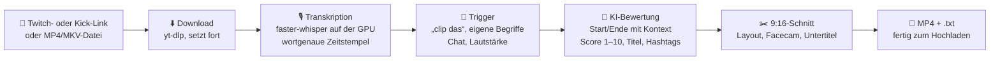
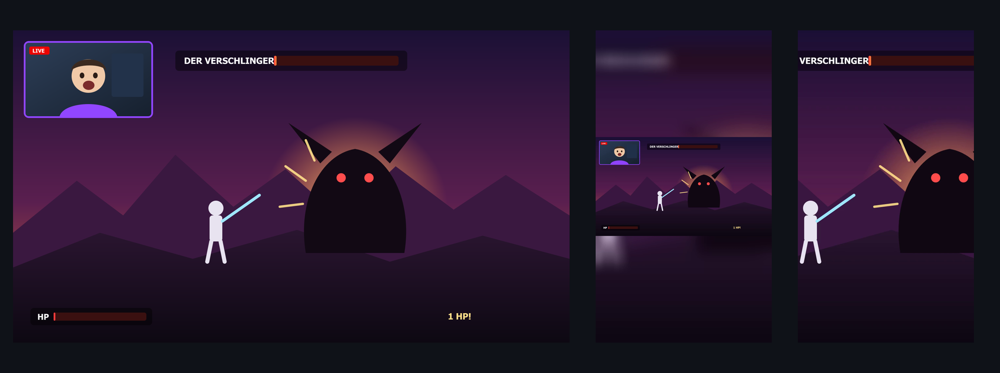

<p align="center">
  
</p>

<p align="center">
  
  
  
  
  
  
</p>

**ClipForge** schaut sich deine kompletten Twitch- oder Kick-VODs an, findet die Momente, die als Kurzclip funktionieren, und schneidet sie fertig im Hochformat für **TikTok, YouTube Shorts und Instagram Reels**. Link rein, Clips raus. Manuell schneiden musst du nicht.

> [!NOTE]
> **Projektstand:** Kommandozeile und `start.bat` funktionieren. Fertig sind Import, Transkription, Trigger, KI-Bewertung und 9:16-Export. Facecam-Layouts, Untertitel und die grafische Oberfläche entstehen gerade. Den Live-Fortschritt siehst du im [Plan](docs/PLAN.md).

---

## Inhalt

- [So funktioniert's](#so-funktionierts)
- [Was schon geht](#was-schon-geht)
- [Installation](#installation)
- [Benutzung](#benutzung)
- [KI-Anbieter und Kosten](#ki-anbieter-und-kosten)
- [Trigger: wie ClipForge Momente findet](#trigger-wie-clipforge-momente-findet)
- [Layouts](#layouts)
- [Speicherorte](#speicherorte)
- [Probleme lösen](#probleme-lösen)
- [Projektstruktur](#projektstruktur)

---

## So funktioniert's



1. **Import:** Du gibst einen Link oder eine Datei an. Lange VODs (8 h und mehr) werden in 10-Minuten-Abschnitten verarbeitet. Bricht etwas ab, macht ClipForge beim nächsten Start genau dort weiter.
2. **Transkription:** Alles Gesagte wird mit Zeitstempel für jedes einzelne Wort erkannt. Das läuft lokal auf deiner NVIDIA-Grafikkarte, kostenlos und ohne Internet.
3. **Trigger:** ClipForge sucht Stellen, an denen du „clip das“ oder einen deiner eigenen Begriffe sagst, auch wenn du dich versprichst oder Dialekt sprichst.
4. **KI-Bewertung:** Eine KI liest das Transkript rund um jede Stelle und entscheidet, wo der Moment wirklich anfängt und aufhört, damit der Clip ohne Vorwissen verständlich ist. Dazu bekommst du einen Viral-Score, Titel, Beschreibung und Hashtags.
5. **Export:** Jeder Clip wird in 1080×1920 geschnitten, mit NVENC auf der GPU kodiert und bekommt eine `.txt` mit Titel, Beschreibung und Hashtags.

---

## Was schon geht

<p align="center">
  
</p>
<p align="center"><sub>Echte Ausgabe von ClipForge aus einem Demo-Streambild. Links das Original (16:9), Mitte Layout <b>blur</b> (alles sichtbar, unscharfer Hintergrund), rechts <b>crop</b> (mittig zugeschnitten). Beim mittigen Zuschnitt fehlen Facecam und Boss. Genau das lösen die Facecam-Layouts und der intelligente Ausschnitt in Meilenstein 4.</sub></p>

| Bereich | Stand | Details |
|---|:---:|---|
| Twitch-VODs per Link | ✅ | inkl. Fortsetzen abgebrochener Downloads |
| Kick-VODs per Link | ✅ | `kick.com/<kanal>/videos/<id>` |
| YouTube und weitere Seiten | ✅ | alles, was yt-dlp kann |
| Lokale Dateien | ✅ | MP4, MKV, MOV, WEBM, FLV, TS |
| Nur einen Ausschnitt laden | ✅ | `--section 1:00:00-1:20:00` |
| Transkription lokal (GPU) | ✅ | faster-whisper `large-v3-turbo`, Sprache automatisch |
| Transkription per API | ✅ | OpenAI Whisper, Groq Whisper |
| Sprachbefehle („clip das“ …) | ✅ | unscharf, mit Kernwort-Prüfung |
| KI-Bewertung | ✅ | 11 Anbieter, siehe unten |
| Kostenschätzung vorab | ✅ | vor Transkription und vor KI-Bewertung |
| 9:16-Export mit NVENC | ✅ | H.264/H.265, 30/60 fps, `.txt` mit Metadaten |
| Eigene Schlüsselbegriffe | 🟡 | in `settings.json`, Oberfläche folgt |
| Chat-Spitzen, Lautstärkespitzen | 🔜 | Meilenstein 3 |
| Facecam-Erkennung und Layouts | 🔜 | Meilenstein 4 |
| TikTok-Untertitel | 🔜 | Meilenstein 5 |
| Grafische Oberfläche (Dark Mode) | 🔜 | Meilenstein 6 |
| Update-Knopf in der App | 🔜 | bis dahin `update.bat` |

**Gemessen** auf einer RTX 5060 Ti:
- **Transkription:** 96 s Testvideo in 9 s
- **Ganzer Ablauf:** 5 min echtes Twitch-VOD in 54 s, inklusive Download, Transkription, Trigger-Suche und Export
- **Export:** 4–6 s pro Clip (NVENC)

---

## Installation

**Du brauchst:**
- Windows 10 oder 11
- [Python 3.11](https://www.python.org/downloads/) (`winget install Python.Python.3.11`)
- eine NVIDIA-Grafikkarte (empfohlen; ohne läuft alles auf der CPU, nur langsamer)

```bat
git clone https://github.com/MoinMornhart/ClipForge.git
cd ClipForge
install.bat
```

`install.bat` richtet alles ein:
- eine eigene Python-Umgebung unter `%LOCALAPPDATA%\ClipForge`
- alle Pakete inklusive der CUDA-Bibliotheken für die GPU
- FFmpeg über winget, falls es fehlt

Am Ende zeigt es eine Systemprüfung:

```text
ClipForge 0.1.0
FFmpeg:   C:\...\ffmpeg.EXE
NVENC:    ja
CUDA-GPU: ja
```

Beim ersten Start lädt ClipForge das Spracherkennungsmodell herunter (ca. 1,6 GB, einmalig).

---

## Benutzung

### Ein-Klick-Start

**`start.bat`** doppelklicken. Dann den Link einfügen oder eine Videodatei ins Fenster ziehen und Enter drücken. Die fertigen Clips landen in `Videos\ClipForge\Export`.

### Kommandozeile

```bat
:: Twitch-VOD komplett analysieren und alle Clips exportieren
start.bat "https://www.twitch.tv/videos/2899619133"

:: Kick-VOD
start.bat "https://kick.com/xqc/videos/a187a188-1fe3-4bdd-bead-7f172b911bba"
```

Für mehr Kontrolle direkt über Python (`cf` steht hier für `%LOCALAPPDATA%\ClipForge\venv\Scripts\python.exe -m clipforge`):

```bat
cf analyze <link-oder-datei>               :: nur analysieren, Clips anzeigen
cf run <link-oder-datei>                   :: analysieren + exportieren
cf run <link> --section 2:00:00-2:30:00    :: nur 30 Minuten ab Stunde 2
cf run <datei> --layout crop               :: anderes Layout
cf run <datei> --no-ai                     :: ohne KI-Bewertung
cf run <datei> -y                          :: Kostenabfrage überspringen
cf check                                   :: Systemprüfung
cf key list | set <anbieter> | delete <anbieter>
cf models <anbieter>                       :: verfügbare Modelle abfragen
```

So sieht eine Analyse aus (Beispielausgabe):

```text
Geschätzte Kosten: Transkription lokal (kostenlos) · KI-Bewertung von 6 Clips ca. 0.06–0.38 $
Fortfahren? [J/n]

6 Clip(s) gefunden:
   1. [8/10] 3:14:02–3:14:41 (39 s)  Boss mit 1 HP besiegt
      Grund: Sprachbefehl: „Klipp das.“ (≈ clip das, 94 %)
      KI: Spannung baut sich auf, Jubel am Ende, funktioniert ohne Vorwissen
      #gaming #bossfight #twitch
```

---

## KI-Anbieter und Kosten

Die KI-Bewertung funktioniert mit allen gängigen Anbietern. Du brauchst nur **einen** davon. Lokale Modelle über Ollama oder LM Studio laufen komplett kostenlos auf deinem PC.

| Anbieter | Key nötig | Schnittstelle |
|---|:---:|---|
| **Anthropic Claude** (Standard: `claude-opus-5-5`) | ✅ | offizielles SDK, strukturierte Antwort |
| OpenAI | ✅ | OpenAI-kompatibel |
| Google Gemini | ✅ | OpenAI-kompatibel |
| Mistral | ✅ | OpenAI-kompatibel |
| Groq | ✅ | OpenAI-kompatibel |
| DeepSeek | ✅ | OpenAI-kompatibel |
| xAI Grok | ✅ | OpenAI-kompatibel |
| OpenRouter (Hunderte Modelle) | ✅ | OpenAI-kompatibel |
| Ollama (lokal) | – | `http://localhost:11434/v1` |
| LM Studio (lokal) | – | `http://localhost:1234/v1` |
| Eigener Server | optional | beliebige OpenAI-kompatible URL |

### API-Key hinterlegen

```bat
cf key set anthropic
API-Key für Anthropic Claude (Eingabe bleibt unsichtbar): ********
Gespeichert in der Windows-Anmeldeinformationsverwaltung.
```

> [!IMPORTANT]
> Keys landen **ausschließlich in der Windows-Anmeldeinformationsverwaltung** (über `keyring`), nie in Dateien, Logs oder im Repo. Für die lokale Transkription braucht ClipForge gar keinen Key, nur die KI-Bewertung.

### Was kostet ein 8-Stunden-VOD?

Diese Schätzung zeigt ClipForge vor jeder Analyse an. Annahme: rund 4 Trigger pro Stunde, also 32 Clips.

| Transkription | KI-Modell | Kosten pro VOD |
|---|---|---|
| lokal (GPU) | Ollama / LM Studio | **0,00 $** |
| lokal (GPU) | Claude Haiku 5.5 | ca. 0,01–0,05 $ |
| lokal (GPU) | Claude Sonnet 5.5 | ca. 0,17–1,03 $ |
| lokal (GPU) | Claude Opus 5.5 | ca. 0,34–2,07 $ |
| Groq Whisper | Claude Opus 5.5 | ca. 0,66–2,39 $ |
| OpenAI Whisper | Claude Opus 5.5 | ca. 3,22–4,95 $ |

Die Spanne kommt daher, dass Claude unterschiedlich lange „nachdenkt“. Für Modelle anderer Anbieter kennt ClipForge die Preise nicht verlässlich. Dort zeigt es „Preis unbekannt“, bis du den Preis in `settings.json` unter `price_overrides` einträgst.

### Wie die KI schneidet

Die KI bekommt das Transkript rund um den Trigger (standardmäßig 120 s davor, 30 s danach) als nummerierte Zeilen und wählt **Start- und Endzeile**. Die genauen Schnittpunkte berechnet ClipForge danach aus den Wortzeitstempeln. Dadurch:

- kann die KI keine Zeiten erfinden,
- beginnt und endet jeder Clip an einer Satzgrenze,
- werden Mindest- und Höchstlänge immer eingehalten (vorne wird gekürzt, die Pointe am Ende bleibt).

---

## Trigger: wie ClipForge Momente findet

ClipForge vergleicht das Transkript unscharf mit deinen Begriffen. Transkript und Begriff werden dafür gleich vereinfacht: Kleinschreibung, Umlaute, k→c, doppelte Buchstaben. Dann wird die Ähnlichkeit gemessen (Levenshtein).

| Gesagt / transkribiert | Begriff | Ergebnis |
|---|---|---|
| „Klipp das!“ | clip das | ✅ erkannt |
| „klipp des bitte“ | clip das | ✅ erkannt |
| „Das muss ein Clip werden.“ | das muss ein clip werden | ✅ erkannt |
| „das ist ein Fehler“ | das ist ein clip | ❌ ignoriert, Kernwort „Clip“ fehlt |
| „wir gehen in den Keller“ | clip das | ❌ ignoriert |

Standard-Befehle: `clip das`, `clip it`, `clippt das`, `das muss ein clip werden`, `das ist ein clip`, `clip that`. Eigene Begriffe (z. B. „boom“, „was geht ab“) trägst du in `settings.json` unter `custom_keywords` ein. Später geht das in der Oberfläche.

> [!TIP]
> Der Fehlalarm „das ist ein Fehler“ stammt aus einem echten Twitch-VOD-Test. Seitdem muss jedes Kernwort eines Begriffs (alles außer Füllwörtern wie „das“, „ist“, „ein“) im Gesagten vorkommen.

---

## Layouts

<p align="center">
  
</p>

| Layout | Wofür | Stand |
|---|---|:---:|
| Facecam oben (⅓), Gameplay unten (⅔) | Standard für Gaming-Clips | 🔜 M4 |
| Gameplay mit kleiner Cam-Ecke | wenn das Spiel im Fokus steht | 🔜 M4 |
| Nur Facecam | Talk- und Reaktionsmomente | 🔜 M4 |
| Gameplay mittig, unscharfer Hintergrund | alles sichtbar, ohne Facecam-Profil | ✅ `blur` |
| Mittig zugeschnitten | Vollbild, nur bei mittigem Geschehen | ✅ `crop` |

Geplant für M4:
- Facecam automatisch per Gesichtserkennung finden (MediaPipe)
- Facecam alternativ per Rechteck markieren und als Profil pro Streamer speichern
- den wichtigen Bildbereich im Gameplay erkennen
- das Gesicht bei Bewegung sanft nachführen

---

## Speicherorte

| Was | Wo |
|---|---|
| Programm | dieser Ordner |
| Python-Umgebung, Sprachmodelle | `%LOCALAPPDATA%\ClipForge\` |
| Einstellungen | `%LOCALAPPDATA%\ClipForge\settings.json` |
| Analysezustand je VOD (zum Fortsetzen) | `%LOCALAPPDATA%\ClipForge\projects\` |
| Logdatei | `%LOCALAPPDATA%\ClipForge\logs\clipforge.log` |
| Heruntergeladene VODs | `Videos\ClipForge\VODs` |
| Exportierte Clips | `Videos\ClipForge\Export` (einstellbar) |

Große Dateien liegen absichtlich nicht im Programmordner, damit iCloud oder OneDrive keine Gigabytes synchronisieren.

---

## Probleme lösen

<details>
<summary><b>„CUDA-GPU: nein“ in der Systemprüfung</b></summary>

`install.bat` erneut ausführen, das installiert die CUDA-Bibliotheken nach. Den Grafikkartentreiber aktualisieren (GeForce Experience oder nvidia.com). Ohne GPU funktioniert alles, die Transkription dauert dann aber etwa 10-mal länger.
</details>

<details>
<summary><b>Kick-Download schlägt fehl</b></summary>

Kick steht hinter Cloudflare. ClipForge nutzt dafür `curl_cffi`. Wenn es trotzdem hakt, `update.bat` ausführen: Das aktualisiert yt-dlp, das Kick-Änderungen meist schnell nachzieht. Der Link muss die Form `kick.com/<kanal>/videos/<id>` haben.
</details>

<details>
<summary><b>Twitch-VOD „existiert nicht“</b></summary>

Twitch löscht VODs je nach Konto nach 7–60 Tagen. VODs nur für Abonnenten lassen sich nicht direkt laden. Dann die Datei manuell herunterladen und als Datei importieren.
</details>

<details>
<summary><b>Analyse abgebrochen – ist alles weg?</b></summary>

Nein. Jeder fertige 10-Minuten-Abschnitt und jeder bewertete Clip wird sofort gespeichert. Einfach denselben Befehl noch einmal starten.
</details>

<details>
<summary><b>Wo finde ich Details zu einem Fehler?</b></summary>

In `%LOCALAPPDATA%\ClipForge\logs\clipforge.log`. Für eine ausführliche Ausgabe den Schalter `-v` anhängen.
</details>

---

## Projektstruktur

```
clipforge/
├── core/          Einstellungen, Logs, Fehler, API-Keys (keyring), FFmpeg, CUDA, Anbieter
├── pipeline/
│   ├── importer   Twitch, Kick, YouTube, Dateien (yt-dlp)
│   ├── transcribe faster-whisper lokal, OpenAI/Groq per API, fortsetzbar
│   ├── triggers   unscharfe Sprachbefehle mit Kernwort-Prüfung
│   ├── llm        KI-Bewertung, Kostenschätzung, alle Anbieter
│   ├── clips      Clip-Kandidaten, Zusammenführen, Längengrenzen
│   ├── render     9:16-Filter, NVENC, Dateinamen, .txt
│   ├── project    Zustand je VOD
│   └── runner     Ablaufsteuerung für Kommandozeile und Oberfläche
├── ui/            PySide6-Oberfläche (in Arbeit)
└── cli.py         Kommandozeile
tests/             pytest
```

**Technik:** Python 3.11, FFmpeg, yt-dlp, faster-whisper (CTranslate2/CUDA), rapidfuzz, Anthropic SDK, OpenAI SDK, MediaPipe/OpenCV. Die Oberfläche wird mit PySide6 (Qt 6) gebaut. Das ist am stabilsten: ein einziger Python-Prozess ohne Brücke zwischen Node und Python, mit eingebautem Videoplayer und direktem Zugriff auf alle Analysebibliotheken.

```bat
%LOCALAPPDATA%\ClipForge\venv\Scripts\python.exe -m pytest tests
```

---

## Aktualisieren

`update.bat` doppelklicken. Das holt die neueste Version von GitHub und aktualisiert die Pakete. Später gibt es dafür einen Knopf in der App.

## Lizenz

MIT, siehe [LICENSE](LICENSE). Lade nur Clips aus Streams hoch, an denen du die Rechte hast.

---

<p align="center"><sub>Verfasst mit Claude 🤖</sub></p>
